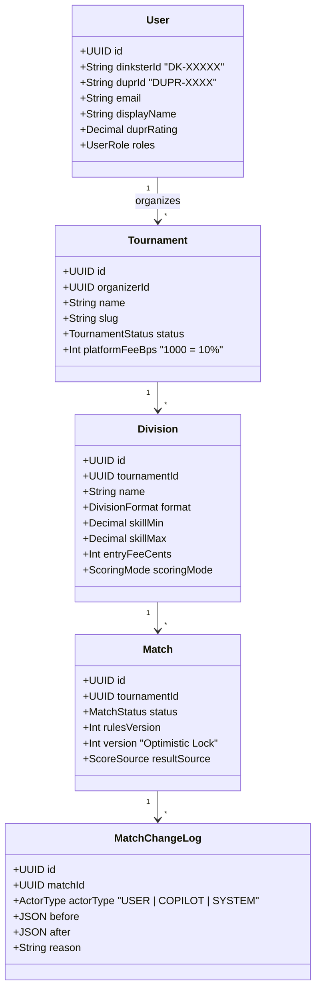
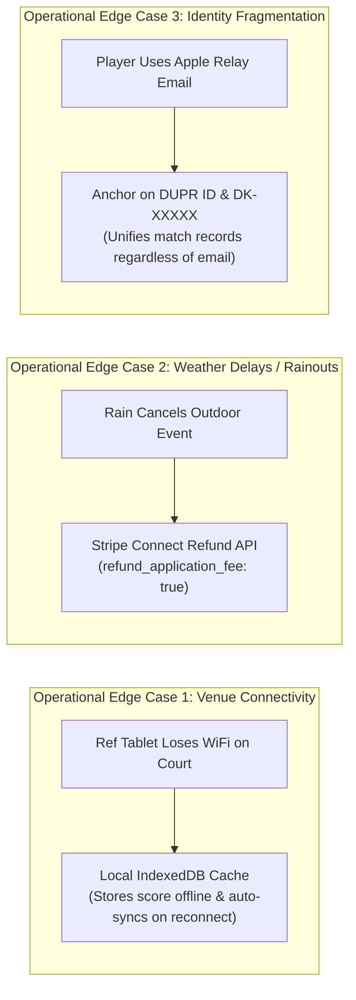
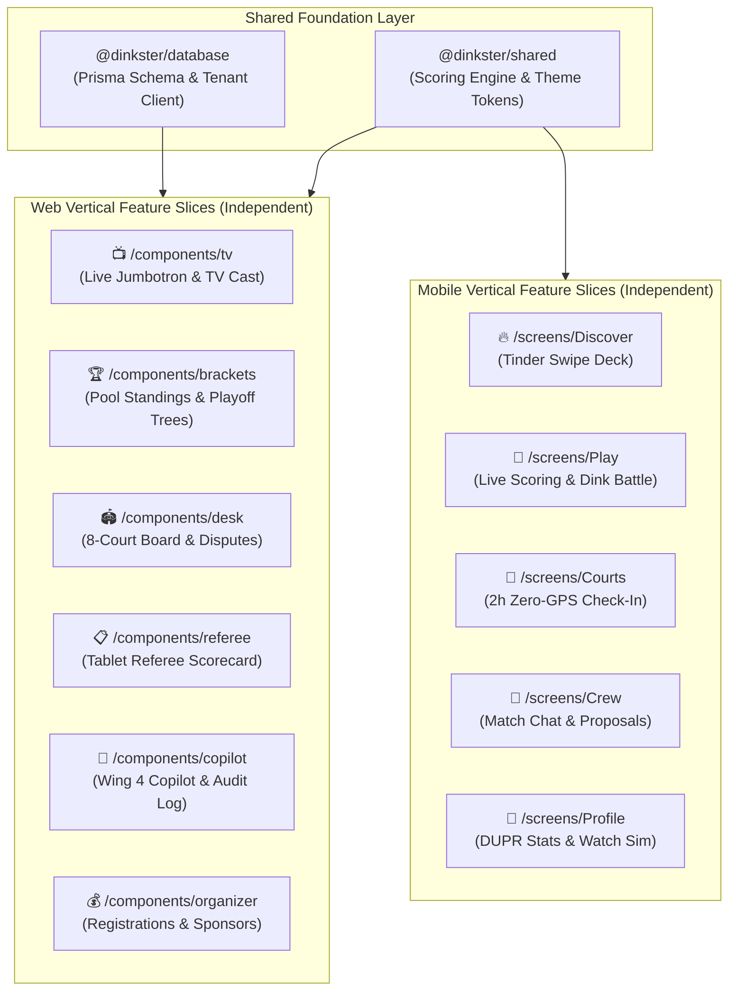

# Dinkster: High-Level Architecture & System Design (A&D)

**Document Type:** High-Level System Architecture & Technical Peer Review Brief  
**Author:** Achut Immani (Founder & Lead Architect)  
**Status:** Approved for Implementation (Sprint 1 Active)  
**Target Audience:** Engineering Leads, System Architects & Technical Advisors  

---

## 1. System Overview & Product Intent

Dinkster is a modern sports operating ecosystem designed specifically for the unique dynamics of pickleball. It addresses the two distinct problems in the sport through **two decoupled, independent product tracks**:

1. **Track A — The Casual Social Problem (Players & Coaches):** How amateur players find compatible partners, locate open courts, check in without privacy invasion, track side-out scoring on their wrist, and play proprietary variations like Dink Battle.
2. **Track B — The Operational Problem (Tournaments & Venues):** How tournament directors collect entry fees, seed divisions by DUPR, schedule 8+ courts in real-time, resolve player disputes, dispatch referees, and run agentic schedule adjustments during weather delays.

### Core Architectural Principle: Strict Decoupling

```mermaid
flowchart TD
    subgraph TRACK_A["Track A: Player Social App (Recreational / Pick-up)"]
        MOBILE["Mobile App (iOS / Android)"]
        WATCH["Apple Watch (Wrist Scoring)"]
        FS["Cloud Firestore (nam5 Multi-Region)"]
        
        WATCH <-->|WatchConnectivity| MOBILE
        MOBILE <-->|Sub-100ms Listeners| FS
        
        NOTE_A["Casual Scope:
        • Tinder Swipe Matchmaking (DUPR & Vibe)
        • Zero-GPS 2-Hour Court Check-in
        • Dink Battle Pilot Variation
        • Wrist Tap-to-Score / Host Override"]
    end

    subgraph TRACK_B["Track B: Tournament Operating System (Commercial / Desk)"]
        WEB["Next.js 14 Web / Tablet Kiosks"]
        PG["Supabase PostgreSQL 15 (ACID)"]
        STRIPE["Stripe Connect (10% Fee Split)"]
        
        WEB <-->|Prisma Tenant Client| PG
        WEB <--> STRIPE
        
        NOTE_B["Operational Scope:
        • Tournament & Division Setup
        • 8-Court Desk Kiosk & Ref Scorecards
        • Dispute Resolution & Incidents
        • Wing 4 Agentic Scheduling Copilot"]
    end

    subgraph ASYNC_BRIDGE["Asynchronous Rating Bridge (Out-of-Band)"]
        DUPR["Official DUPR Platform<br/>(Universal Rating Authority)"]
        
        PG -.->|Export Official Match Results| DUPR
        DUPR -.->|Async Pull Verified Ratings & History| FS
    end
```

> **The Golden Rule:** Tournament players do **NOT** enter tournament scores on their personal phones during official tournament play. Official scores are entered by Referees or Court Desk staff on Track B. Track A and Track B **never meet synchronously on court**. DUPR serves as the universal rating bridge between them.

---

## 2. Technology Stack & Component Model

The system is maintained in a single TypeScript monorepo with strict package boundaries:

| Layer | Technology | Primary Role | Architectural Trade-offs & Rationale |
|---|---|---|---|
| **Mobile Client (Track A)** | React Native (Expo SDK 51, TypeScript) | Cross-platform player app (iOS & Android). | Fast dual-platform iteration; Swift reserved for WatchKit target. |
| **Watch Companion** | WatchKit via `@bacons/apple-targets` | Wrist tap-to-score and Digital Crown undo. | Operates over `WatchConnectivity` through the phone for ultra-low latency on court. |
| **Mobile Realtime Data** | Cloud Firestore (`nam5` Multi-Region) | Reactive listeners (&lt;100ms), offline cache for pick-up play. | Built for offline court resilience and reactive live score sharing among friends. |
| **Web Platform (Track B)** | Next.js 14 App Router + Tailwind CSS | Tournament dashboard, public landing pages, desk kiosk, referee tablet. | Server-rendered SEO for tournament registration pages; instant optimistic UI for desk staff. |
| **Relational Database** | PostgreSQL 15 (Supabase) + Prisma ORM | Multi-tenant schema, ACID transactions, Stripe ledger, Copilot change log. | Relational integrity and tenant isolation required for tournament operations. |
| **Payments** | Stripe Connect | Direct registration payouts to organizers; 10% platform fee retained. | Compliant escrow and automated fee splitting without taking custody of funds. |
| **Cloud Hosting (Web)** | Firebase App Hosting / Cloud Run | Scalable web hosting consolidated under the `dinkster-pb` GCP project. | Single-vendor Google billing; eliminates multi-cloud overhead. |
| **Shared Business Logic** | `@dinkster/shared` | Pure TypeScript scoring engine, theme tokens, geofence, and check-in utils. | Zero runtime dependencies; shared identically across mobile and web. |
| **Database & Multi-Tenancy** | `@dinkster/database` | Prisma schema, migrations, and tenant isolation extensions. | Enforces tenant scoping (`organizerId`) at the application layer. |

---

## 3. Core Domain Entities & Identity Model

### Identity Conventions & Locked Rules
1. **Dinkster Player ID:** Strictly **`DK-XXXXX`** (e.g. `DK-49281`). Used for friend discovery, casual matchmaking, and internal platform tracking.
2. **DUPR ID:** Strictly alphanumeric (e.g. `DUPR-8X92KP`). Used as the sanctioned rating anchor for tournament seeding and external match history imports.
3. **Casual Game Join Code:** Strictly **`D-XXXX`** (e.g. `D-7741`), entered via standard uppercase OS keyboard (custom pinpads prohibited).
4. **Team Names:** Default to player initials (e.g. `"AJ & MR"`), editable inline by host.
5. **Silent Host Override:** Host score adjustments resolve disputes silently without jarring opponent alert popups.
6. **Dink Battle Pilot Format:** Configurable game mode where after the 5th shot of a rally, the court shrinks to half-court.

---

## 4. Peer Review Risk Assessment & Implemented Mitigations

During technical peer review, 5 primary architectural hypotheses were raised. Following the architectural decision to decouple Track A and Track B, each has been addressed with concrete code implementations:

| # | Peer Review Risk | Why It Matters | Concrete Architectural Mitigation | Code Location |
|---|---|---|---|---|
| **1** | **No link between Firebase & Supabase** | Match results cannot reach tournament organizers | **Decoupled Architecture**: In tournament play, referees and desk staff enter scores directly on Track B (Supabase). The two tracks do not need synchronous on-court linkage. An **HMAC-SHA256 signed webhook endpoint** with idempotency keys is implemented for out-of-band result ingestion. | `apps/web/src/lib/webhookVerifier.ts` `apps/web/src/app/api/webhooks/matches/complete/route.ts` |
| **2** | **Firebase JWT vs Supabase RLS** | Supabase Row-Level Security cannot inspect Firebase tokens | **Isolated Auth Domains + BFF Bridge**: Mobile players communicate exclusively with Firebase Auth/Firestore; organizers communicate with Supabase. A **BFF Identity Bridge** verifies Firebase Bearer tokens and maps them to Postgres User records when mobile users access web APIs. | `apps/web/src/lib/auth.ts` `apps/web/src/app/api/v1/tournaments/route.ts` |
| **3** | **Prisma bypasses Postgres RLS** | Superuser connection string could allow cross-tenant tournament data leaks | **Prisma Tenant Client Extension**: Implemented `createTenantClient(organizerId)` extension that automatically injects `where: { organizerId }` on all queries and throws `TenantIsolationError` on missing or unauthorized tenant contexts. | `packages/database/src/tenantClient.ts` `packages/database/src/index.ts` |
| **4** | **Firestore TTL is not exact** | 2-hour court check-ins could linger up to 72 hours due to Firestore GC lag | **Deterministic Expiration Engine**: Created pure utilities (`createCheckInRecord`, `isCheckInActive`, `filterActiveCheckIns`) that enforce strict `expiresAt = now + 120min`. Stale records are filtered out instantly on both client and server reads. | `packages/shared/src/utils/checkIn.ts` `apps/mobile/src/screens/CourtsScreen.tsx` |
| **5** | **Geofence vs Privacy Promise** | Risk of user GPS coordinates leaking to backend servers | **Zero-GPS Device Protocol**: Client-side Haversine formula (`calculateDistanceMeters`, `isWithinGeofence`) executes strictly on device CPU. Network check-in payload contains only `{ courtId, dinksterId, verifiedLocally, expiresAt }` with 0 coordinates stored. | `packages/shared/src/utils/geofence.ts` `apps/mobile/src/screens/CourtsScreen.tsx` |

---

## 5. Remaining Operational Risks & Production Safeguards

With real-time cross-database synchronization removed, the architecture has only three operational edge cases to manage:

1. **Court Desk Offline Resilience (Track B):**
   - *Risk:* Remote tournament courts often have weak WiFi or cell connectivity.
   - *Safeguard:* Tablet scorecards cache pending score submissions locally in browser storage and flush to PostgreSQL once connectivity is restored.
2. **Rain Delays & Tournament Cancellations (Track B):**
   - *Risk:* In the event of weather cancellations, organizers must issue full refunds.
   - *Safeguard:* Handled via Stripe Connect Destination Charges with `refund_application_fee: true` to prevent manual accounting overhead.
3. **Identity Fragmentation (Cross-Platform):**
   - *Risk:* A player logs into mobile using Apple Private Relay but enters a tournament using their personal Gmail.
   - *Safeguard:* The `duprId` and permanent `DK-XXXXX` serve as the universal identity anchors across both tracks.

---

## 6. Implementation Verification Matrix

| Component | Status | Verification Check |
|---|---|---|
| `@dinkster/shared` | **Verified (0 errors)** | `npm run build` &rarr; Pure scoring engine, themes, geofence, and checkIn utils. |
| `@dinkster/database` | **Verified (0 errors)** | `npm run build` &rarr; Prisma 5 schema, 14 tables, `createTenantClient`. |
| `apps/mobile` | **Verified (0 errors)** | `npm run typecheck` &rarr; 5 tab navigation, Live scoring, Apple Watch simulator, zero-GPS court check-in with 2h expiration. |
| `apps/web` | **Verified (0 errors)** | `npm run build` &rarr; Next.js 14 production build, Desk Kiosk, Ref Scorecard, Copilot, Signed Webhooks, Tenant API routes, TV Jumbotron, Brackets & Medals. |

---

## 7. Vertical Feature Slice Architecture & Regression Isolation

Every major artifact and capability in Dinkster is engineered as an **isolated vertical feature slice**. Features share the backend database (`@dinkster/database`) and core scoring engine (`@dinkster/shared`), but maintain zero circular UI dependencies:

### Key Engineering Rules:
1. **Isolated Blast Radius:** Modifying TV Casting or Bracket Progression cannot break registrations or court desks. Any regression is strictly contained within that feature slice.
2. **Independent Shippiability:** Slices can be enabled, disabled, mocked, or shipped as independent feature flags or micro-frontends without rewriting core code.
3. **Single Contract with DB:** All writes pass through the verified multi-tenant Prisma client (`createTenantClient`) ensuring global data safety across all slices.
