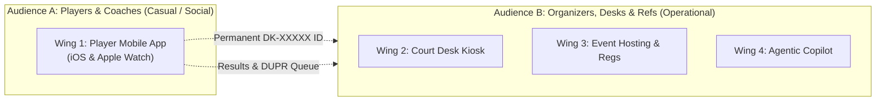
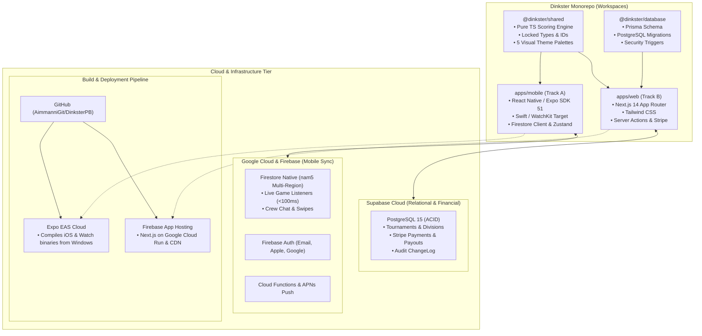
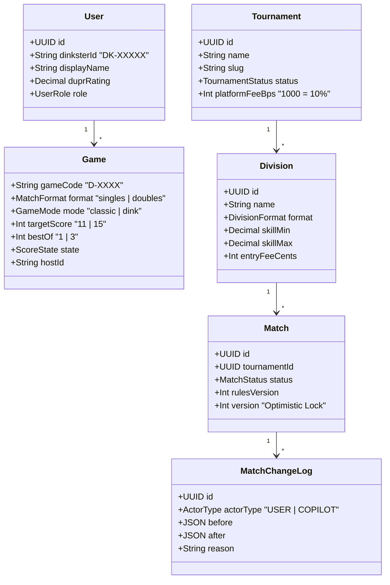

# Dinkster: High-Level Architecture & System Design (A&D)

**Document Type:** High-Level System Architecture & Peer Review Brief  
**Author:** Achut Immani (Founder & Lead Architect)  
**Status:** Approved for Implementation (Sprint 1 Active)  
**Target Audience:** Engineering Leads, System Architects & Technical Advisors  

---

## 1. System Overview & Product Intent

Dinkster is a cross-platform social sports platform built specifically for pickleball. It solves the two biggest bottlenecks in amateur sports:
1. **The Discovery Bottleneck (Finding People):** Tinder-style swipe discovery based on DUPR skill rating, schedule availability, and proximity, supported by 2-hour court check-ins.
2. **The Operational Bottleneck (Playing & Scoring):** Real-time, multi-device on-court scoring across phones and the Apple Watch, backed by tournament desk management and AI-assisted scheduling.

### Architectural Boundary: The Two Audiences
Dinkster is divided into two distinct product surfaces to prevent feature bloat:



- **Player App (Wing 1):** Built exclusively for players and coaches. Tournament bracket trees, court calls, and administrative alerts are **strictly suppressed** from the mobile app to keep the user experience social, fast, and clean.
- **Organizer Platform (Wings 2, 3, 4):** A responsive web and tablet-kiosk application for tournament directors, court desk staff, and referees.

---

## 2. High-Level Architecture & Component Model

The system is organized as a unified monorepo running two decoupled, parallel runtime tracks:



---

## 3. Technology Stack & Rationale

| Layer | Technology | Why Selected | Trade-offs Considered |
|---|---|---|---|
| **Mobile Client** | React Native (Expo SDK 51, TypeScript) | Single codebase targeting iOS and Android with near-native performance. | Native Swift was rejected to allow fast dual-platform updates. |
| **Watch Companion** | Swift / WatchKit via `@bacons/apple-targets` | Enables native wrist tap-to-score and Digital Crown undo over `WatchConnectivity`. | Standalone watch app deferred to Phase 2; uses phone as bridge. |
| **Mobile Realtime Data** | Cloud Firestore (`nam5` Multi-Region) | Sub-100ms document synchronization, offline caching on courts, native reactive listeners. | Supabase Realtime evaluated; Firestore chosen for proven mobile offline reliability. |
| **Web Platform** | Next.js 14 App Router + Tailwind CSS | Server-side rendering for SEO (public event pages) and fast client interactions for desk kiosks. | Vite SPA rejected due to lack of SEO for tournament landing pages. |
| **Relational Database** | PostgreSQL 15 via Supabase & Prisma ORM | Strict relational integrity, schema migrations, complex joins for tournament draws, and audit logging. | Firestore rejected for tournaments due to lack of multi-table ACID transactions. |
| **Payments** | Stripe Connect | Direct splits: entry fees go to organizers; 10% platform fee retained automatically. | Custom payment processor rejected for legal/payout compliance. |
| **Cloud Hosting (Web)** | Firebase App Hosting / Google Cloud Run | Consolidates all web, database, and auth billing under one Google Cloud account (`dinkster-pb`). | Vercel evaluated; Firebase chosen to avoid multi-vendor sprawl. |
| **CI / CD (Mobile)** | Expo Application Services (EAS Build) | Enables building native iOS and Apple Watch binaries from a Windows development environment. | Local Mac mini runner rejected in favor of zero-maintenance cloud workers. |

---

## 4. Core Domain Entities & Locked Conventions



### Locked Product Directives
1. **Identity & Codes:**
   - Permanent Player ID: Strictly **`DK-XXXXX`** (e.g., `DK-X7K2P`).
   - Game Join Code: Strictly **`D-XXXX`** (e.g., `D-7741`), uppercase alphanumeric, typed into a standard OS keyboard (custom keypads prohibited).
   - Team Naming: Defaults to player initials (e.g., `"AJ & MR"` vs. `"JC & SK"`), editable inline by the host.
2. **Scoring Engine (`@dinkster/shared`):**
   - Traditional side-out scoring (point scored only when serving).
   - Doubles: Two-server rule (first team to serve starts on Server 2). Singles: Server continues until rally lost.
   - Deciding Set Side Switch: Switch ends when the first team reaches 6 points.
   - **Silent Host Override:** Host adjustments resolve scoring disputes silently without broadcast alerts to opponents.
3. **Dink Battle (Proprietary Pilot Variation):**
   - After the 5th shot of a rally, the court shrinks to half court. Dinks decide the point; lobs and deep drives land out.
   - Implemented as a configurable game mode flag (`GameMode.DINK_BATTLE`) in the engine.
4. **Copilot Guardrails (Wing 4):**
   - Tool tiers: `READ` &rarr; `PROPOSE` &rarr; `COMMIT`.
   - `COMPLETED` matches are strictly immutable (enforced by service layer and Postgres triggers).
   - All rule pivots (e.g., shortening pool matches to 9 during rain delays) compute projected finish deltas and log before/after snapshots to `MatchChangeLog`.

---

## 5. Security, Privacy & Integrity

1. **Check-In Privacy Mask:**
   - Court check-in requires geofence verification (within 500m of venue).
   - Exact coordinates are never stored or broadcast. Opponents see only `First Name + Last Initial` and DUPR rating.
   - Presence auto-expires via TTL after 2 hours.
2. **Score Precedence:**
   - `HOST_OVERRIDE` > `REFEREE` > `SELF_REPORTED` > `IMPORTED`. Lower authority cannot overwrite higher authority.
3. **Database Guardrails:**
   - Row-Level Security (RLS) policies isolate tournament organizer data.
   - Optimistic concurrency control via `Match.version` prevents race conditions during live score submissions.

---

## 6. Peer Review Risk Analysis & Production Mitigations (Implemented)

During architectural peer review, 5 critical system risks were identified. Each risk has been directly mitigated with production code implemented across `@dinkster/shared`, `@dinkster/database`, `apps/web`, and `apps/mobile`:

| Risk Identified | Failure Mode | Production Architectural Fix | Implemented In |
|---|---|---|---|
| **1. No link between Firebase & Supabase** | Casual match results cannot reach tournament organizers | HMAC-SHA256 signed webhook endpoint (`/api/webhooks/matches/complete`) with 5-min drift prevention and idempotency key caching (`checkIdempotencyKey`, `recordIdempotencyKey`). | `apps/web/src/lib/webhookVerifier.ts`<br/>`apps/web/src/app/api/webhooks/matches/complete/route.ts` |
| **2. Firebase JWT vs Supabase RLS** | Supabase Row-Level Security cannot read Firebase Auth tokens | Backend-for-Frontend (BFF) Auth Bridge verifies Firebase tokens, auto-provisions synchronized user records with permanent `DK-XXXXX` format, and maps Firebase `uid` to Postgres User UUID. | `apps/web/src/lib/auth.ts`<br/>`apps/web/src/app/api/v1/tournaments/route.ts` |
| **3. Prisma bypasses Postgres RLS** | Superuser connection string could leak cross-tenant organizer records | Prisma Client Extension (`createTenantClient`) injects mandatory `organizerId` filters across all tournament queries, throwing `TenantIsolationError` on missing or unauthorized tenant contexts. | `packages/database/src/tenantClient.ts`<br/>`packages/database/src/index.ts` |
| **4. Firestore TTL is not exact** | 2-hour court check-ins could linger up to 72 hours due to Firestore GC lag | Deterministic `expiresAt` timestamp generation (`createCheckInRecord`) and strict read-time filtering (`isCheckInActive`, `filterActiveCheckIns`) on both client UI and server APIs. | `packages/shared/src/utils/checkIn.ts`<br/>`apps/mobile/src/screens/CourtsScreen.tsx` |
| **5. Geofence vs Privacy Promise** | Risk of user GPS coordinates leaking or persisting server-side | Pure client-side Haversine distance calculation (`calculateDistanceMeters`, `isWithinGeofence`) executing exclusively on device CPU. Server payloads (`ClientVerifiedCheckInPayload`) strictly omit coordinates. | `packages/shared/src/utils/geofence.ts`<br/>`apps/mobile/src/screens/CourtsScreen.tsx` |

```mermaid
flowchart TD
    subgraph CLIENT["Mobile Device (Track A)"]
        GPS["Device GPS Sensor"] -->|Local CPU Only| GEO["Haversine Geofence<br/>(@dinkster/shared)"]
        GEO -->|Zero Coordinates Leakage| PAYLOAD["Verified Check-In Payload<br/>(courtId, DK-ID, verifiedLocally, expiresAt)"]
        PAYLOAD -->|Store / Sync| FS["Firestore Native"]
        FS -->|Filter Active Only| READ["UI Read Filter<br/>(now < expiresAt)"]
    end

    subgraph BRIDGE["Secure Webhook & BFF Layer (Track B)"]
        FS -.->|On Match Complete| CF["Firebase Cloud Function"]
        CF -->|POST with HMAC-SHA256 & Idempotency Key| WH["/api/webhooks/matches/complete"]
        WH -->|verifyWebhookSignature| VFY["HMAC Verifier<br/>(crypto.timingSafeEqual)"]
        VFY -->|Idempotency Check| DEDUP["checkIdempotencyKey()"]
        DEDUP -->|Prisma Upsert| PG["Supabase PostgreSQL 15"]
    end

    subgraph TENANT_GUARD["Multi-Tenant Isolation (Wing 3 & 4)"]
        AUTH["authenticateRequest()"] -->|Decode Firebase JWT| USER["Authenticated User (DK-ID)"]
        USER -->|Pass organizerId| TENANT["createTenantClient(organizerId)"]
        TENANT -->|Auto-Inject where: { organizerId }| QUERY["Tenant-Isolated Queries"]
        QUERY --> PG
    end
```

---

## 7. Peer Review Checklist & Discussion Topics

For technical advisors and peer reviewers, the primary areas for evaluation are:

- [ ] **Dual-Database Strategy:** Is the split between Firestore (mobile presence, chat, live scores) and Supabase Postgres (tournaments, payments, audit logs) justified by the separation of audiences, or should it eventually be consolidated?
- [ ] **Apple Watch Connectivity:** Does relying on `WatchConnectivity` through the phone handle latency well on the court, or should direct WiFi/Cellular Watch websockets be prioritized for Phase 2?
- [ ] **Offline Resilience:** While casual play relies on local state with optimistic sync, should a dedicated local SQLite queue be introduced for tournament referee tablets in low-connectivity venues?
- [ ] **Dink Battle IP Protection:** Does keeping rule parameters in JSON config sufficiently isolate the pilot format while patent and trademark filings are underway?
