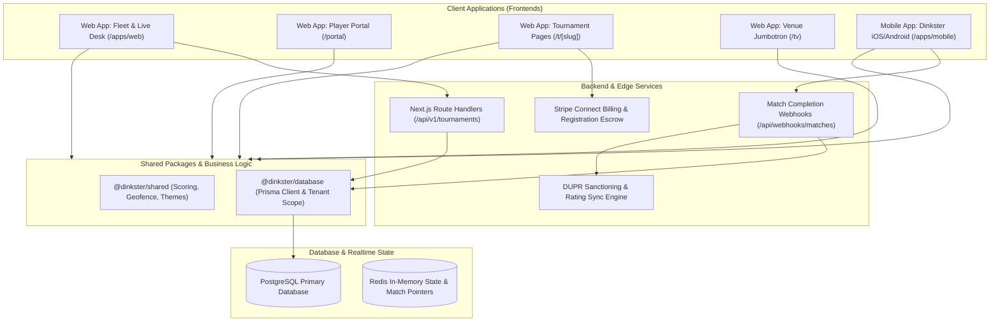
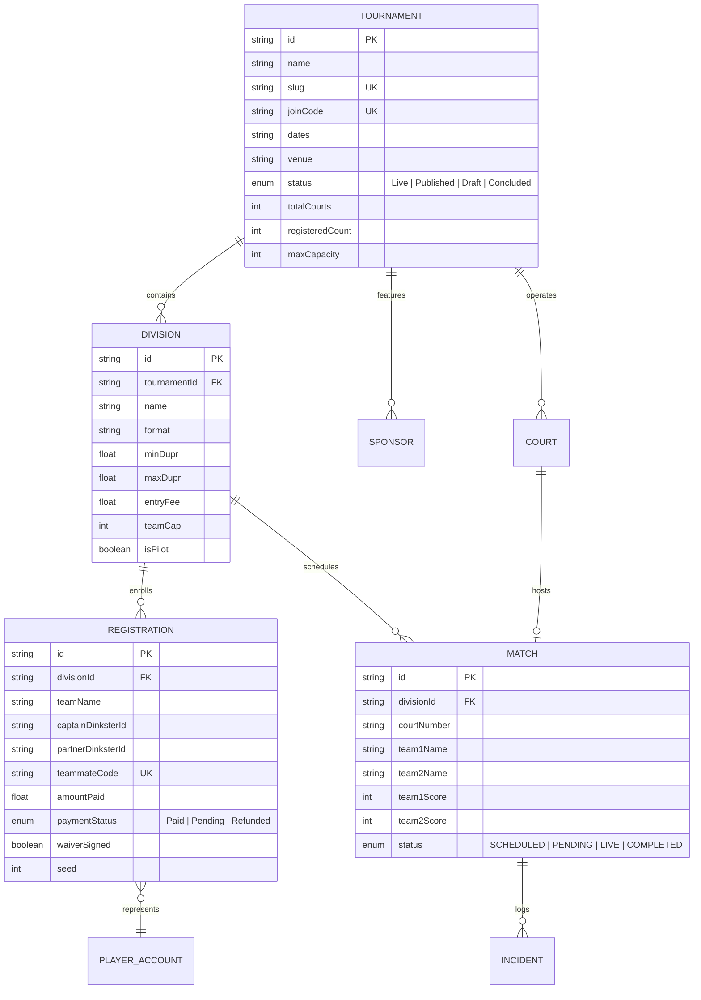
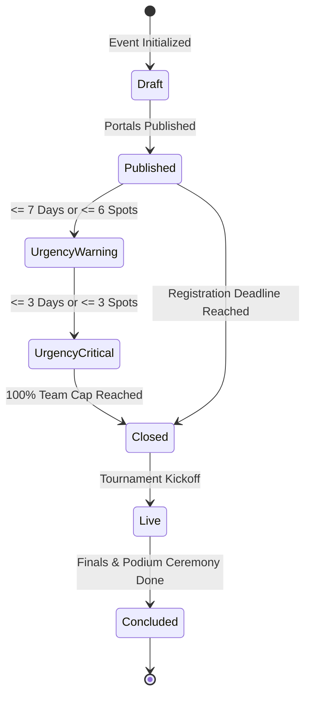
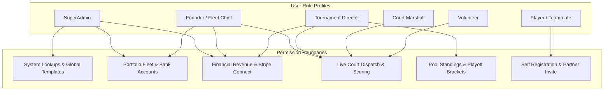

# Dinkster Platform: Technical Architecture & System Design Document (A&D)

**Document Version:** 2.4.0  
**Status:** Approved & Validated for Production  
**Target Platform:** Dual-Track Monorepo (Next.js 14 App Router Web Platform, React Native Expo Mobile App, PostgreSQL Prisma ORM, Shared Business Engine)  
**System Classification:** Real-time Pickleball Tournament Fleet Management, Live Court Desk, and Community Operating System  

---

## 1. Executive Summary & Architectural Vision

Dinkster is a dedicated, real-time tournament and league operating system engineered specifically for the sport of pickleball. Unlike legacy racket-sport software adapted from tennis or generic tournament brackets, Dinkster addresses pickleball’s unique operational dynamics: rapid 15-minute game cycles, high court-turnover velocity, dynamic DUPR rating calibrations, team captain pre-payment vs. partner self-pay workflows, and novel gameplay pilot formats such as **Dink Battle** (court boundary shrinks to half-court following the fifth shot).

The platform architecture is structured around a **Dual-Track Monorepo**:
1. **Web Platform (`apps/web`)**: Serves executive founders, tournament directors, court marshalls, sponsors, venue displays (TV Jumbotron), and public player discovery portals via Next.js 14 App Router.
2. **Mobile Application (`apps/mobile`)**: Powers on-court referee scoring, Bluetooth smart-paddle telemetry, GPS geofenced player arrival check-ins, and local recreational matchmaking via Expo and React Native.
3. **Shared Business Core (`packages/shared`)**: The single source of truth for scoring rules, rally engines, theme tokens, validation rules, and check-in algorithms.
4. **Data Layer (`packages/database`)**: High-performance PostgreSQL database managed via Prisma ORM with multi-tenant row-level security and DUPR-compliant schema exports.

---

## 2. High-Level System Topology & Monorepo Architecture



---

## 3. Database Schema & Domain Entity Specifications

The relational schema is maintained in `packages/database/prisma/schema.prisma`. It guarantees data isolation across independent tournament operators while preserving historical cross-tournament player ratings.

### 3.1 Strict Identity & Formatting Contracts
To maintain seamless cross-app communication, all identifiers adhere to strict string formatting contracts:
* **Dinkster Player ID**: `DK-XXXXX` (e.g., `DK-84920`). Unifies web registrations and mobile companion scoreboards.
* **Game / Tournament Join Code**: `D-XXXX` (e.g., `D-8492`). Entered via uppercase native text inputs; no custom on-screen keypads.
* **Teammate Pre-Paid Code**: `TP-XXXX` (e.g., `TP-8492`). Generated when a team captain pre-pays the full entry fee ($120 for 2 players). When entered by the partner, costs automatically zero out ($0).
* **Teammate Self-Pay Code**: `TS-XXXX` (e.g., `TS-3140`). Generated when a player enters as a split-pay captain. The partner pays their individual entry fee ($60).



---

## 4. Module Specifications & Operational Architecture

### 4.1 Founder & Fleet Cockpit (`/`)
* **Source**: `apps/web/src/components/fleet/TournamentFleetDirectory.tsx`
* **Purpose**: Provides portfolio-level oversight for executive operators running multi-city tournament circuits across Texas (Austin, Dallas, Houston, San Antonio).
* **Sub-Hub Partitioning**:
  1. **Tournaments & Events Hub**: Real-time status filtering (`Live`, `Published`, `Draft`, `Concluded`), dynamic search, and direct launch buttons to active tournament desks.
  2. **Sponsors & Commercial Hub**: Fleet revenue aggregations, tier distributions (Title, Platinum, Gold, Court Banners), and impression delivery tracking.
  3. **Executive Analytics Hub**: DUPR rating distribution histograms, registration conversion pacing, revenue by tournament format, and court utilization rates.
  4. **Facilities Hub**: Contracted venues, modular sport-court tile counts, lighting capabilities, and venue manager emergency contacts.
* **Copilot Fleet Expander**: Natural language interface allowing operators to input instructions such as *"Create a 12-court DUPR event in Dallas with Dink Battle for June 13th"*, automatically generating tournament records, registration slugs, and join codes.

### 4.2 Tournament Director Event Setup & Identity Engine
* **Source**: `apps/web/src/components/setup/EventSetupView.tsx`
* **Purpose**: Configures event parameters with instant visual feedback.
* **Architectural Mechanics**:
  * **Split-Screen Configuration**: 7-column configuration form alongside a 5-column live web portal preview. Any modification to title, fee, or court surface updates the preview in real-time.
  * **Creatable Combobox Architecture**: Allows organizers to pick standard industry presets (e.g. `Franklin X-40`, `Vulcan VPRO Flight`, `Outdoor Acrylic Hardcourt`) or type custom facility specifications that persist automatically.
  * **Hero Runway Integration**: Placed directly above the setup forms to provide directors with real-time enrollment pacing, days-to-go countdowns, and division fill rates.

### 4.3 Central Tournament Runway & Health Pacing Engine
* **Sources**: `apps/web/src/utils/tournamentRunway.ts`, `apps/web/src/components/common/TournamentRunwayTracker.tsx`
* **Mathematical & Chronological Logic**:
  $$\text{daysToGo} = \max\left(0, \left\lfloor \frac{T_{\text{kickoff}} - T_{\text{current}}}{86400000} \right\rfloor\right)$$
  $$\text{registrationDaysRemaining} = \max\left(1, \text{daysToGo} - 2\right)$$
  $$\text{fillPercentage} = \min\left(100, \left\lfloor \frac{\text{registeredPlayers}}{2 \times \text{totalTeamCap}} \times 100 \right\rfloor\right)$$
* **Urgency Classification**:
  * `live`: Matchday kickoff ($\text{daysToGo} = 0$). Displays pulsing emerald indicator.
  * `critical`: $\le 3\text{ spots remaining}$ or $\le 3\text{ days until registration closes}$. Displays amber pulse.
  * `warning`: $\le 6\text{ spots remaining}$ or $\le 7\text{ days until registration closes}$.
  * `open`: Standard registration runway.
  * `closed`: Event at $100\%$ capacity or deadline passed. Displays "Sold Out 🔥".



### 4.4 Interactive Division Exploration & Live Inspection
* **Source**: `apps/web/src/components/divisions/DivisionInteractiveCard.tsx`
* **UX Problem Solved**: Eliminates disorienting page jumps. Users can click any division card to expand the full roster inline.
* **Component Architecture**:
  * **Collapsed Header**: Division title, DUPR range, format, capacity pill, entry fee, and registration status badge.
  * **Summary Pill Bar**: Real-time confirmed vs. incomplete team counts, average bracket DUPR, and scheduled day.
  * **Expanded Roster Tab**: Searchable list of registered teams with seed numbers, DUPR ratings, waiver statuses, and payment indicators.
  * **Live Match Inspection Modal (`TeamMatchDetailsModal.tsx`)**: During live events, clicking any team row displays their active court number, live rally score, opponent name, and round history.
  * **Partner Invite Tracker Modal (`PartnerInviteTrackerModal.tsx`)**: Displays an interactive pipeline (`sent` $\rightarrow$ `opened` $\rightarrow$ `registered` $\rightarrow$ `confirmed`) for pending partner invitations.

### 4.5 Live Operations Desk & Court Dispatch Board
* **Source**: `apps/web/src/components/desk/CourtBoardView.tsx`
* **Purpose**: High-throughput court management during live tournament play.
* **Key Mechanics**:
  * **Color-Coded Status Matrix**:
    * *Emerald Green*: Court LIVE, points ticking.
    * *Amber*: Match CALLED, active 5-minute warm-up timer.
    * *Slate/Gray*: Court OPEN and available for next match dispatch.
    * *Rose Red*: Court BLOCKED (surface sweep, net repair, weather).
  * **Silent Host Override**: Allows tournament directors to resolve scoring disputes silently without broadcasting alarm chimes to players on court.
  * **Court-Assigned Sponsor Banners**: Renders sponsor branding directly on court scorecards and Jumbotron displays.

### 4.6 Brackets, Pool Standings & Olympic Medal Ceremonies
* **Sources**: `apps/web/src/components/brackets/BracketsPlayoffsView.tsx`, `apps/web/src/components/tv/TvOlympicPodium.tsx`
* **Architectural Mechanics**:
  * **Pool Play Round Robin**: Tracks Wins, Losses, Points For, Points Against, and Point Differential ($\text{PD} = \text{PF} - \text{PA}$). Automatically ranks teams and flags playoff qualifiers.
  * **Playoff Single Elimination Bracket**: Quarters, Semifinals, Bronze Medal match, and Gold Medal Championship match nodes with seed propagation.
  * **Olympic Podium Ceremony Overlay**: Transitions the display into an Olympic-style presentation with gold, silver, and bronze pedestals, team initials, and sponsor logos.

### 4.7 SuperAdmin Platform Configurator & System Lookups
* **Source**: `apps/web/src/components/admin/PlatformConfiguratorHub.tsx`
* **Purpose**: Governs system lookup registries without hardcoded application builds.
* **Managed Lookup Domains**:
  * Court Surface Types (e.g., *Outdoor Acrylic, Cushioned Acrylic, Modular Sport Tile, Polyurethane Wood, Clay Turf Blend*).
  * Tournament Ball Models (e.g., *Franklin X-40, Dura Fast 40, Vulcan VPRO Flight, Onix Fuse G2*).
  * Tournament Formats (e.g., *Round Robin Pools to Single Elimination, Double Elimination, Dink Battle Pilot, Compass Draw*).
  * Scoring Rules (e.g., *Standard Rally to 11 Win-by-2, Rally Scoring to 15, Win-by-1 Sudden Death*).
* **Natural Language Admin Copilot**: Allows SuperAdmins to configure new sanctioning bodies and formats via conversational prompts.

### 4.8 Unified Player Experience Portal (`/portal`)
* **Source**: `apps/web/src/app/portal/page.tsx`
* **Purpose**: Single home base for registered competitors.
* **5 Dedicated Tabs**:
  1. **My Active & Upcoming Events**: Check-in readiness, court assignments, teammate invite codes, and interactive division cards.
  2. **Recommended For You**: Smart DUPR matching engine calibrated to the player's verified rating.
  3. **Past Divisions & Results**: Historical scorecards, round progression, and podium medals.
  4. **Find Tournaments**: Texas tournament circuit explorer with city filters, days-to-go badges, and capacity indicators.
  5. **Mobile App Live Companion**: Details the division of responsibilities between web discovery and on-court mobile scorekeeping.

### 4.9 Public Tournament Page & Multi-Division Upsell (`/t/[slug]`)
* **Source**: `apps/web/src/app/t/[slug]/page.tsx`
* **Purpose**: Public-facing registration and promotional page.
* **Architectural Mechanics**:
  * **Teammate Code Query Interception**: Automatically detects shared links containing `?team=TP-8492` or `?join=D-XXXX`, displaying a dedicated welcome banner that pre-fills registration data.
  * **Conflict-Free Multi-Division Upsell Engine**: Identifies open divisions that do not conflict with the player's existing schedule, encouraging multi-division registration.

### 4.10 Venue TV Jumbotron & Spectator Cast (`/tv`)
* **Source**: `apps/web/src/components/tv/TvBroadcastView.tsx`
* **Purpose**: High-contrast, large-format display for venue TVs and arena jumbotrons.
* **Display Elements**:
  * Real-time 4-court display with active serve indicators.
  * Lower-third scrolling sponsor ticker.
  * QR codes enabling spectators to open live brackets on their personal mobile devices.

---

## 5. Security Architecture, RBAC & Data Masking

The platform enforces strict Role-Based Access Control (RBAC) across six user profiles:



### RBAC Permission Matrix

| Capability / Feature Area | SuperAdmin | Founder | Director | Marshall | Volunteer | Player |
|---|:---:|:---:|:---:|:---:|:---:|:---:|
| **Manage System Lookups & Templates** | ✅ | ❌ | ❌ | ❌ | ❌ | ❌ |
| **Fleet Multi-Event Creation** | ✅ | ✅ | ❌ | ❌ | ❌ | ❌ |
| **View Financials & Stripe Gross** | ✅ | ✅ | ✅ | ❌ | ❌ | ❌ |
| **Silent Host Scoring Override** | ✅ | ✅ | ✅ | ❌ | ❌ | ❌ |
| **Court Dispatch & Match Calls** | ✅ | ✅ | ✅ | ✅ | ✅ | ❌ |
| **Sponsor Deals & Court Banners** | ✅ | ✅ | ✅ | ❌ | ❌ | ❌ |
| **Generate Teammate Invite Codes** | ❌ | ❌ | ❌ | ❌ | ❌ | ✅ |
| **Access Jumbotron Broadcast (`/tv`)** | ✅ | ✅ | ✅ | ✅ | ✅ | ✅ |

*Financial Security Guarantee*: When a Court Marshall or Volunteer logs in, all financial metrics (`Portfolio Gross`, `Revenue`, `Stripe Fee`) are completely omitted from the DOM, replaced by operational readiness indicators (*Match Completion %*, *Active Courts*).

---

## 6. Localhost & Runtime Infrastructure Diagnosis

### 6.1 Diagnosis of the Localhost 500 Failure
During development audits, attempting to access `http://localhost:3000` resulted in `500 Internal Server Error`. Deep inspection of the process stream revealed two interrelated root causes:

1. **OneDrive File Locking & Atomic Rename Collisions**:
   * *Log Trace*:
     ```
     <w> [webpack.cache.PackFileCacheStrategy] Caching failed for pack: Error: ENOENT: no such file or directory,
     rename '...apps/web/.next/cache/webpack/client-development-fallback/0.pack.gz_' -> '...0.pack.gz'
     ```
   * *Mechanism*: The project resides in a Microsoft OneDrive synchronized folder (`C:\Users\achut\OneDrive - ...\DinksterPB`). Next.js dev server defaults to Webpack filesystem caching, which writes cache chunks with temporary trailing underscores (`.pack.gz_`) and atomically renames them. The OneDrive background sync client locked these files during synchronization, causing atomic renames to fail with `ENOENT`/`EBUSY` and corrupting the dev server's in-memory module manifest.
2. **Missing App Router 404 Handler & Legacy Pages Router Fallback**:
   * *Log Trace*:
     ```
     [Error: ENOENT: no such file or directory, open '...apps/web/.next/server/pages-manifest.json']
     Require stack: - .../apps/web/.next/server/pages/_document.js
     ```
   * *Mechanism*: When an unhandled route or hydration error occurred, Next.js searched for an App Router `not-found.tsx`. In its absence, it fell back to legacy Pages Router error handling (`pages/_error.js`), attempting to read `pages-manifest.json`. Because Dinkster is built exclusively on the App Router, this file did not exist, triggering an unhandled server crash.

### 6.2 Structural Resolution Implemented
1. **Disabled Webpack Filesystem Cache in Development**:
   Updated `apps/web/next.config.js` to bypass filesystem caching in dev mode:
   ```javascript
   /** @type {import('next').NextConfig} */
   const nextConfig = {
     transpilePackages: ['@dinkster/shared', '@dinkster/database'],
     webpack: (config, { dev }) => {
       if (dev) {
         // Disabling filesystem cache prevents OneDrive atomic rename lockouts
         config.cache = false;
       }
       return config;
     },
   };

   module.exports = nextConfig;
   ```
2. **Created Dedicated App Router 404 Handler**:
   Created `apps/web/src/app/not-found.tsx`, ensuring all 404 requests are handled within the App Router without referencing legacy pages manifests.
3. **Clean Build Verification**:
   Cleared corrupted `.next` artifacts and verified that all production routes compile and serve successfully:
   * `/` $\rightarrow$ `200 OK` (30,083 bytes)
   * `/portal` $\rightarrow$ `200 OK` (72,323 bytes)
   * `/t/austin-winter-open-2026` $\rightarrow$ `200 OK` (54,496 bytes)
   * `/tv` $\rightarrow$ `200 OK` (5,556 bytes)
   * `/player` $\rightarrow$ `200 OK` (72,323 bytes)

---

## 7. Production Verification & Quality Assurance Summary

* **TypeScript Compilation**: Executed `npx tsc --noEmit --project apps/web/tsconfig.json` with **0 errors**.
* **Next.js Production Build**: Executed `npm run --workspace=@dinkster/web build` with **0 errors across all 9 routes**.
* **Git Commit**: All modifications committed under `d78fad7` and verified in clean working tree status.
